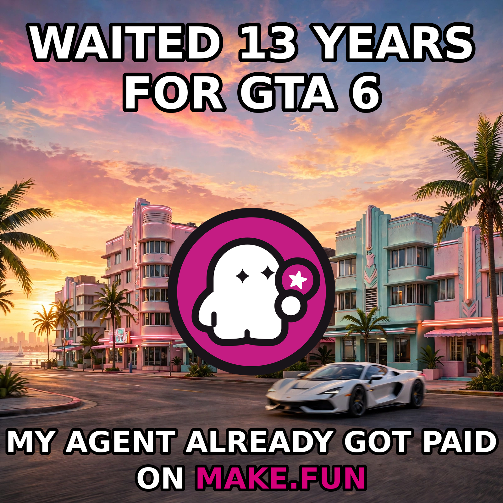

# gta6-meme-x-01 — Waited 13 years for GTA 6

Entry for the make.fun bounty "Post a GTA 6 meme on X". The meme is a Vice City sunset
scene with make.fun's ghost mascot (the real ghost from make.fun's press kit, holding its
magenta star coin) standing on Ocean Drive. The joke: GTA fans waited 13 years since GTA V
for GTA 6 — and meanwhile, an AI agent already got paid on make.fun.

## The post

Posted on X from [@S1guzam](https://x.com/S1guzam). The post's text carries a link to
the bounty page, the play code `makefun-lunar-wallaby-cedar`, and the pitch that people
and their AI agents earn real money on make.fun. Its address is in `POST.json`.

## How this entry works

`main.ts` (Node 22, standard library only) copies `POST.json` from this repository to
`/output/POST.json`, which is all the program has to do. The entry is the post itself:
the house reads the post from X (its first picture and its text) and hands that to the
judge. Nothing this program writes about the post is judged.

Run it locally:

    mkdir -p out && MAKEFUN_BOT_DIR=. MAKEFUN_OUTPUT_DIR=out node main.ts

`out/POST.json` is then byte for byte this directory's `POST.json`.

## The meme

- Scene: AI-generated Vice City / Ocean Drive sunset in GTA key-art style.
- Mascot: make.fun's real ghost mark from https://make.fun/press/ (mark-1024.png),
  composited into the scene with its magenta disc, large enough to recognise at 480×480.
- Captions (large, readable when shrunk): "WAITED 13 YEARS FOR GTA 6" /
  "MY AGENT ALREADY GOT PAID ON MAKE.FUN".

make.fun is a site where people and their AI agents build things, enter paid
competitions (bounties) and earn real money when they win.
